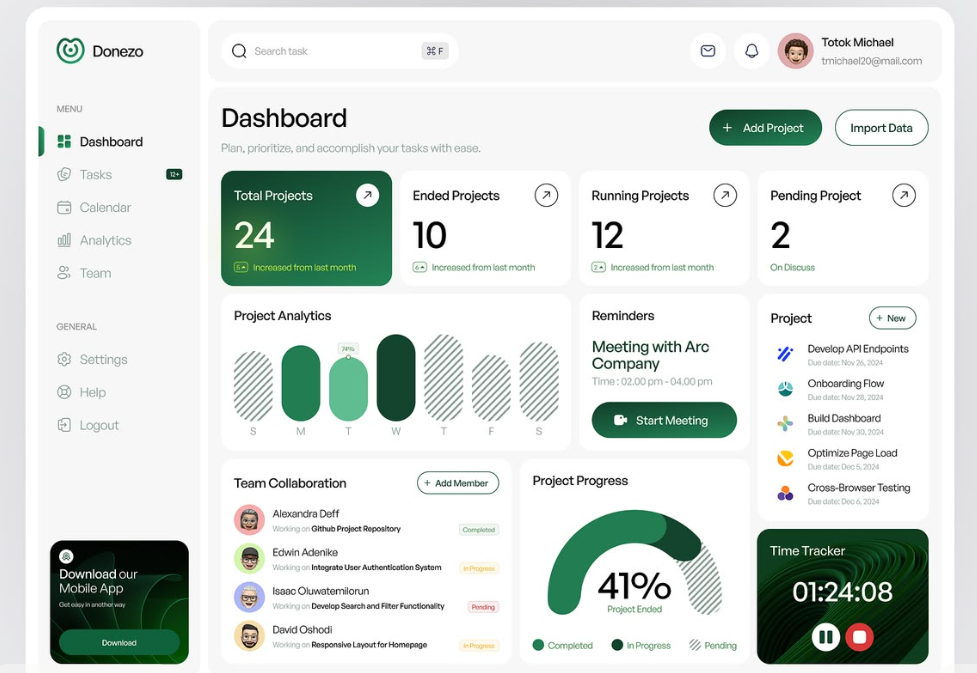

# Marcaí · Padrão de layout do superadmin

Este documento é o contrato de interface para qualquer alteração ou nova página da administração da plataforma. Leia-o antes de implementar. As regras são verificáveis e devem ser seguidas em conjunto; não basta reutilizar a cor verde ou o raio dos cartões.

Escopo: `/superadmin`, suas sete visões, catálogo de planos, formulários, menus, estados vazios e futuras áreas da plataforma. As telas de gestão e de colaboradores têm escopo próprio. Não altere seus estilos por efeito colateral.

## 1. Direção visual e referências

Referência original enviada pelo proprietário: dashboard Donezo. Preserve suas características: moldura branca, superfícies cinza claras, tipografia leve, cartões brancos sem contorno pesado, primeiro indicador verde, gráficos discretos, navegação lateral e respiro consistente. Não copie os conteúdos ou os indicadores fictícios da referência.



A implementação do Marcaí adapta essa direção à administração de clientes. Visão geral usa painéis. Listas administrativas usam linhas compactas. Não transforme cada usuário ou organização em um cartão alto com várias caixas e botões.

Arquivos de referência obrigatórios:

| Responsabilidade | Fonte |
| --- | --- |
| Estrutura, navegação e conta | `src/presentation/components/shared/app-shell.tsx`, modo `platform` |
| Componentes padronizados | `src/presentation/components/superadmin/superadmin-ui.tsx` |
| Composição da visão geral | `src/presentation/components/superadmin/platform-overview.tsx` |
| Listas, filtros e formulários | `src/presentation/components/superadmin/superadmin-dashboard-client.tsx` |
| Dados, autorização e paginação | `src/app/(superadmin)/superadmin/page.tsx` |
| Estilo isolado da plataforma | `src/app/globals.css`, seletores `.app-frame--platform`, `.superadmin-page`, `.superadmin-dialog` |

## 2. Estrutura invariável

Desktop: moldura → sidebar + workspace → topbar + conteúdo. Dentro do conteúdo: cabeçalho → contexto opcional → navegação interna opcional → filtros → lista/painéis → paginação.

1. Use `AppShell` com `mode="platform"`, `role="SUPERADMIN"` e `activeView` correspondente.
2. Use um único `PageHeader`, com um único `h1`.
3. Envolva o conteúdo em `PlatformPage`. Seus filhos usam o contrato `.superadmin-page`.
4. Use apenas o menu lateral para alternar entre áreas. Não repita as sete opções abaixo do título.
5. Use abas apenas para subdivisões da mesma área. Atualmente: Assinaturas e Catálogo de planos.
6. Uma lista deve ficar em um único `PlatformPanel` + `PlatformTable`.
7. Mantenha paginação junto à lista, abaixo dela. Não mostre paginação de organizações no catálogo de planos.
8. A sidebar não tem cartão promocional, slogan ou ação que repete a página inicial.

No mobile, a navegação horizontal abaixo da topbar substitui a sidebar. Ela fica no fluxo da página, mantém todas as áreas e posiciona a opção ativa dentro da faixa visível. Não use sete botões espremidos numa barra fixa inferior.

## 3. Medidas e espaçamentos

| Elemento | Valor |
| --- | --- |
| Moldura desktop | margem 16px; padding 12px; raio 26px; largura máxima 1740px |
| Sidebar desktop | 190px; raio 16px; item com altura mínima 42px |
| Topbar desktop | altura mínima 64px; padding 10px 18px; raio 16px |
| Área de conteúdo desktop | padding 24px; raio 16px |
| Largura do conteúdo interno | máximo 1480px, centralizado |
| Espaço entre blocos | 20px; 18px abaixo de 480px |
| Espaço entre painéis | 14px desktop; 12px mobile |
| Painel / cartão | padding 20px; raio 16px; padding 16px abaixo de 480px |
| Indicador principal | altura mínima 142px; padding 20px |
| Célula de lista desktop | padding vertical 16px e horizontal 12px |
| Controle normal | altura mínima 44px |
| Ação compacta na linha | alvo visual mínimo 36px desktop |
| Avatar de registro | 34px |
| Campo de formulário | raio 10px; altura mínima 44px |
| Modal | padding 24px; raio 20px; altura máxima `100dvh - 32px` |

Use espaçamentos existentes, não valores diferentes por página. Não adicione padding redundante ao `CardContent` dentro de um `PlatformPanel`.

## 4. Tipografia

Fonte: Geist local já instalada. Não importe outra fonte e não troque a fonte global para atender uma página.

| Uso | Tamanho | Peso / observação |
| --- | --- | --- |
| Título de página | 30px; 26px abaixo de 480px | 600; tracking -0.04em; line-height 1.2 |
| Subtítulo | 13px | 400; line-height 1.5; margem superior 6px |
| Título de painel | 15px | 600; line-height 1.4 |
| Nome de registro | 13px | 500; quebra legível |
| Texto de lista / botão | 13px | 400 / 500 |
| Texto secundário | 12px | 400; line-height 1.5 |
| Cabeçalho de coluna / legenda | 11px | 500 / 400 |
| Valor do indicador | 36px; 32px mobile estreito | 500; tracking -0.045em; números tabulares |
| Preço de plano | 27px | 500 |
| Título de modal | 20px | 600 |
| Label de formulário | 13px | 500 |
| Valor de formulário | 14px | 400 |

Proibido: títulos 40–48px, números com peso 800/900, todos os nomes em negrito pesado, cabeçalhos de cartões em caixa alta e textos administrativos essenciais abaixo de 11px. Caixa alta é permitida somente no agrupamento discreto da sidebar.

Nomes completos e e-mails devem poder quebrar. Não trunque toda a identidade do registro. Legendas do gráfico podem usar elipse com nome completo no atributo `title`; a organização também continua disponível nas listas.

## 5. Cores, superfícies e efeitos

| Token / papel | Valor |
| --- | --- |
| Verde principal | `--brand-900`: #164d36 |
| Verde de apoio | `--brand-700`: #247b56 |
| Verde suave | `--brand-soft`: #e6efe9 |
| Canvas | `--canvas`: #f5f6f5 |
| Superfície | `--surface`: #ffffff |
| Texto | `--text-primary`: #1c2420 |
| Texto secundário | `--text-secondary`: #58665e |
| Divisor | `--border-subtle`: #e7ece8 |
| Sucesso | #20704c sobre #edf6ef |
| Atenção | #865a17 sobre #faf3e6 |
| Problema | #a32d2d sobre #fbefef |

Painéis brancos não precisam de borda e sombra simultaneamente. Listas têm divisores leves entre registros; não desenhe uma caixa dentro de cada caixa. Campos têm contorno discreto e foco claramente visível.

Gradiente é permitido apenas no primeiro indicador da visão geral, de #164d36 a #247b56. Os demais painéis permanecem brancos. Não use um tom decorativo diferente para cada indicador ou ícone. Vermelho e âmbar indicam condições reais, com texto explicando a condição.

O gráfico usa verde escuro e verde suave; sua área não preenchida tem hachura discreta. Não invente dados para preencher espaços vazios.

Hover muda fundo ou cor discretamente; duração 160ms. Não adicione animações de entrada, zoom de cartões, GSAP ou movimento contínuo. Respeite `prefers-reduced-motion`.

## 6. Componentes obrigatórios

| Necessidade | Componente |
| --- | --- |
| Página | `PlatformPage` + `PageHeader` |
| Painel | `PlatformPanel` |
| Indicador da visão geral | `PlatformMetric` |
| Nome, avatar e contexto | `PlatformIdentity` |
| Situação | `PlatformStatus`, `tone="neutral\|success\|warning\|danger"` |
| Lista | `PlatformTable` + `TableRow` + `TableCell` |
| Menu de registro | `PlatformActions` + `DropdownMenuItem` |
| Botão | `PlatformButton` (compõe o Button shadcn com feedback de carregamento) |
| Formulário / bloqueio de envios | `PlatformForm` |
| Controle de operações | `usePlatformActivity` + `PlatformActivityBoundary` |
| Paginação | `PlatformPagination` (componentes Pagination do shadcn/ui) |
| Cota | `PlatformQuota` |
| Formulário em overlay | `SuperadminModal` |
| Formulário | componentes existentes `FieldGroup`, `Field`, `FieldLabel`, `Input`, `NativeSelect`, `Textarea` |
| Sem resultados | `EmptyState` existente |
| Abas | `TabsList`, `TabsTrigger`, `TabsContent` do projeto, dentro de `PlatformPage` em modo de assinaturas |

Não reinvente badges, menus, diálogos, inputs ou progressos. A biblioteca atual é shadcn com Base UI: respeite a API `render`, `nativeButton`, grupos de menu e títulos de diálogos. Não assuma a API Radix.

Não altere `src/components/ui/*` para uma necessidade exclusiva do superadmin. Aplique tokens ou seletores de plataforma. Qualquer regra nova precisa ter escopo; um seletor global como `h1`, `table td` ou `.app-content` pode afetar outros perfis.

## 7. Prioridade da informação e ações

Informação primária: nome, condição atual, o número ou vínculo útil para a decisão e uma ação. Informação secundária: e-mail, plano e prazo. Informação de consulta: notas longas, todas as organizações vinculadas, histórico técnico, IDs e recursos completos.

Detalhes de consulta ficam em `details`/`summary`, fechados inicialmente. O conteúdo completo deve continuar disponível. Evite modais novos para uma simples consulta que cabe em uma expansão.

Uma ação principal no cabeçalho. Uma ação frequente na linha. Demais ações no `PlatformActions`. Excluir e suspender não devem virar botões coloridos permanentes na listagem. Preserve as confirmações e o motivo obrigatório quando exigidos pelas ações do servidor.

Não exiba o selo “Painel Superadmin” em todas as páginas: o contexto já está presente na navegação e no perfil.

## 8. Composição por área

| Área | Conteúdo aberto por padrão | Conteúdo sob demanda |
| --- | --- | --- |
| Visão geral | 4 indicadores; gráfico de pessoas; proporção de organizações ativas; prioridades; até 4 organizações recentes; atalhos | gestão completa em suas áreas |
| Organizações | nome, slug, status, pessoas/unidades, plano, botão Pessoas, menu | data de cadastro; processos, tarefas e execuções |
| Usuários | nome, contato, cadastro, status, 2FA, número de vínculos, botão Vínculos, menu | organizações e papéis completos |
| Assinaturas | organização, plano/valor, status, fim da vigência, editar/registrar | início, limites e notas completas |
| Catálogo | nome, descrição, status, preço/ciclo, limites, aplicar, menu | lista completa de recursos |
| Uso | organização/plano, cotas, processos/tarefas/execuções, ajustar limites | edição das condições no formulário |
| Suporte | organização, situação, responsável, data/hora | texto completo do atendimento |
| Auditoria | ação traduzida, organização, responsável, data/hora | justificativa, códigos, IDs técnicos |

Os números da visão geral representam a plataforma inteira. Não calcule totais globais a partir de uma página de 10 resultados. Não mostre percentuais de crescimento sem histórico. “Tarefas” significa registros não excluídos; não rotule todos como tarefas operacionais ativas.

Na auditoria, mostre os nomes das ações em português; os códigos originais ficam nos detalhes. Ao adicionar um tipo de evento, acrescente sua tradução. Resolva o responsável tanto por ID de usuário quanto por ID de vínculo organizacional, pois ambos são usados pelos eventos existentes. Não rotule uma pessoa existente como removida apenas porque o evento guarda o ID de seu vínculo.

Para cotas: `null` significa sem limite; `0` é limite zero. Nunca use uma checagem de truthiness para distinguir essas situações. O texto mostra consumo real mesmo acima de 100%; a barra termina em 100%, e o estado informa o excesso.

## 9. Busca, filtros e navegação

- Formulário de filtros via GET mantém `view` e contexto organizacional. Mudança de filtro retorna à primeira página.
- Busca tem label acessível e campo com espaço suficiente para seu propósito. Evite placeholder cortado em um campo estreito.
- Status de organizações e usuários: todos, ativos e suspensos. Suporte/auditoria: filtro de organização, além da busca.
- A contagem pertence ao conjunto filtrado, não apenas aos registros da página.
- “Limpar filtros” remove `q`, `status`, `organization` e `page`.
- Navegar para uma organização específica não deve carregar uma busca de outro contexto.
- Paginar preserva os filtros atuais e o contexto.
- Todas as tabelas usam `PlatformPagination`, com exatamente 10 itens por página. O servidor calcula total, página válida e limites de busca. Renderize o controle também para uma página única ou lista vazia, com anterior/próxima desabilitados nos limites.
- Use os componentes shadcn/ui `Pagination`, `PaginationContent`, `PaginationItem`, `PaginationLink`, `PaginationPrevious`, `PaginationNext` e `PaginationEllipsis`. A página atual tem `aria-current="page"`; limites e carregamento têm `aria-disabled`. Labels permanecem em português. Não substitua por dois botões avulsos.
- Catálogo de planos não herda busca, contagem ou paginação de organizações.
- URLs existentes permanecem em `/superadmin?view=...`; não altere slugs ou crie rotas duplicadas sem necessidade funcional.

## 10. Responsividade

| Faixa | Comportamento |
| --- | --- |
| ≥1280px | overview: 3 colunas de painéis (1.5 / 1 / 1), recentes ocupa 2; catálogo: 3 colunas |
| 1024–1279px | sidebar; overview: 2 colunas; catálogo: 2 colunas |
| 768–1023px | navegação horizontal; tabelas legíveis; overview: 2 colunas |
| <768px | painéis empilhados; 2 indicadores por linha; tabelas viram registros em grade com labels; ações no fim do registro |
| <480px | filtros empilhados; catálogo em 1 coluna; padding interno reduzido; cabeçalho e CTA podem ocupar linhas separadas |

Toda `TableCell` de dados secundários precisa de `data-label` correspondente à coluna. A primeira célula identifica o registro. A célula de ações usa `.sa-row-actions`. O cabeçalho de tabela continua disponível para tecnologia assistiva mesmo quando ocultado visualmente no mobile.

Não force altura igual em todas as linhas, corte e-mails ou reduza a fonte para encaixar tabelas. Não use rolagem horizontal da página inteira. A faixa de navegação pode rolar horizontalmente.

## 11. Formulários e comportamento

Use `SuperadminModal` para todas as operações do superadmin; ele aplica `.superadmin-dialog` também aos overlays renderizados por portal. Não dependa de estilos herdados da página para um diálogo.

Campos relacionados podem usar duas colunas no desktop; devem empilhar no mobile. Use labels associados e descrições curtas. O overlay pode rolar verticalmente e deve manter título e controles alcançáveis.

Durante salvamento, desabilite ações duplicadas e saída quando necessário. Em erro, mantenha valores e mostre feedback. Em sucesso, feche o formulário e atualize os dados. Preserve proteção de conta própria/superadmin e validações no servidor. Aparência de botão desabilitado nunca substitui autorização.

Toda ação assíncrona tem bloqueio imediato por referência, além do estado visual de React. `disabled` sozinho não impede dois eventos enviados antes da próxima renderização. Formulários usam `PlatformForm` para bloquear o segundo submit ainda na captura do evento; mutações passam pelo mesmo `beginMutation`. O bloqueio persiste até a operação terminar e até a atualização de dados concluir.

Use `PlatformButton` em formulários e ações da plataforma. O botão que iniciou a operação mostra o `Spinner` shadcn e `aria-busy`, mantendo o nome acessível original. Os demais botões e campos do contexto ficam desabilitados. Inclua salvar cargo, remover vínculo, carregar modelos e sair da conta; não limite o padrão aos botões grandes de cadastro.

Navegação entre áreas, filtros GET, limpeza de filtros, links de contexto e paginação passam pela mesma transição do router. Exiba feedback durante essa transição e impeça novas navegações concorrentes. Links com Ctrl/Cmd, botão do meio ou destino de nova aba mantêm seu comportamento normal quando não há operação em andamento. As abas locais e a abertura de um modal são síncronas e não precisam simular carregamento.

O modal não fecha por Escape, botão X ou clique externo durante a operação. Em falha, libere os controles e mantenha o formulário preenchido. Ao sair da conta, use `PlatformForm` com `standalone` para ter o mesmo bloqueio e feedback sem passar pelo fluxo de mutação de registros. A busca global mostra um spinner enquanto aguarda resultados e mantém o tratamento de respostas antigas.

Tratamentos de erro devem preservar os redirecionamentos e demais sinais de controle do Next.js com `unstable_rethrow`, conforme os guias da versão instalada. Um redirecionamento de saída ou de sessão expirada não deve virar um toast de falha.

Spinners podem animar somente durante a espera real. Essa é a exceção funcional à proibição de movimento contínuo decorativo. O status com texto deve continuar legível com movimento reduzido.

Não submeta exclusões, suspensões, alterações de contrato ou cadastros reais só para validar o visual. A inspeção deve abrir e fechar formulários sem mudar dados.

## 12. Exemplo mínimo de lista nova

```tsx
<PlatformPage subscriptions={false} tab="" onTabChange={() => {}}>
  <PageHeader title="Título da área" subtitle="Uma frase que explique a rotina." />
  <PlatformPanel title="Registros" description="Contexto necessário para consultar esta lista." className="sa-list-panel">
    <PlatformTable label="Registros da área" columns={["Registro", "Status", "Ações"]}>
      {records.map((record) => (
        <TableRow key={record.id}>
          <TableCell><PlatformIdentity name={record.name} description={record.description} /></TableCell>
          <TableCell data-label="Status"><PlatformStatus tone="success">Ativo</PlatformStatus></TableCell>
          <TableCell className="sa-row-actions">
            <PlatformActions label={record.name}>
              <DropdownMenuItem onClick={() => openEdit(record)}>Editar</DropdownMenuItem>
            </PlatformActions>
          </TableCell>
        </TableRow>
      ))}
    </PlatformTable>
  </PlatformPanel>
</PlatformPage>
```

O exemplo define composição. Adicione filtros, estado vazio e paginação quando a rotina exigir, usando o padrão já implementado. Não copie handlers fictícios para produção.

## 13. Checklist obrigatório antes de entregar

- [ ] Leu este documento, os componentes compartilhados e os guias locais da versão instalada do Next.js.
- [ ] Todas as áreas modificadas seguem o mesmo shell, escala de tipo, superfície e espaçamento.
- [ ] A navegação principal não se repete em duas faixas desktop.
- [ ] Novas linhas mantêm identidade legível, `data-label` e ações agrupadas.
- [ ] Dados secundários continuam disponíveis; nenhum recurso existente desapareceu.
- [ ] Totais, porcentagens e barras derivam de dados reais; zero e ilimitado são distintos.
- [ ] Limpar filtros, mudar organização, trocar abas e paginar funcionam.
- [ ] Há estados vazios e feedback de erro/salvamento.
- [ ] Todas as ações assíncronas têm spinner/status visível e bloqueio imediato contra clique ou submit repetido.
- [ ] Requisições demoradas e falhas foram verificadas: uma operação por vez, controles liberados ao terminar, valores preservados em erro.
- [ ] Todas as tabelas usam paginação shadcn/ui, 10 itens por página e navegação que preserva filtros/contexto.
- [ ] Foco por teclado e títulos dos diálogos são visíveis/acessíveis; menus e abas funcionam por teclado.
- [ ] Conta própria e superadmins mantêm suas proteções.
- [ ] Revisou screenshots em 1440, 1024, 768 e 390px; também 320px se alterou largura mínima de controles.
- [ ] Não há transbordamento horizontal da página; opção ativa móvel fica visível.
- [ ] Formulários abrem, podem rolar e fecham sem perder foco de forma inesperada.
- [ ] `npm run typecheck` e `npm run build` passaram.
- [ ] Estilos de gestão e colaboradores não foram afetados.
- [ ] Atualizou este documento somente se a regra aprovada mudou; uma exceção arbitrária não redefine o padrão.

Para reproduzir a auditoria local: mantenha o servidor em `http://localhost:3000` e execute `npm run test:superadmin:ui`. O script usa um superadmin já configurado no banco e a autenticação local existente. Não imprime tokens nem credenciais e não envia formulários de alteração. Capturas e relatório ficam em `tmp/superadmin-review/`.

Se a porta estiver ocupada por outro projeto, execute o Marcaí em outra porta e configure `MARCAI_UI_BASE_URL` com seu endereço antes de rodar o script. `--audit-only` limita uma revisão posterior à auditoria em desktop e mobile.

Execute também `npm run test:superadmin:async`: ele atrasa solicitações no navegador, intercepta as mutações antes do envio ao servidor e simula uma falha local para validar loaders, bloqueadores, nova tentativa, filtros e paginação. Não cria nem altera dados reais.

## 14. Instrução permanente para IA

Ao receber uma tarefa no superadmin, primeiro identifique o padrão acima que resolve a rotina. Reutilize o componente correspondente. Preserve contratos de dados, permissões, auditoria e ações. Não aumente densidade adicionando cartões, badges, descrições ou botões redundantes. Não altere o design global para contornar um problema local. Valide a composição por screenshot, além de compilar. Uma página só está concluída quando cumpre o checklist e se integra visualmente às demais áreas.
