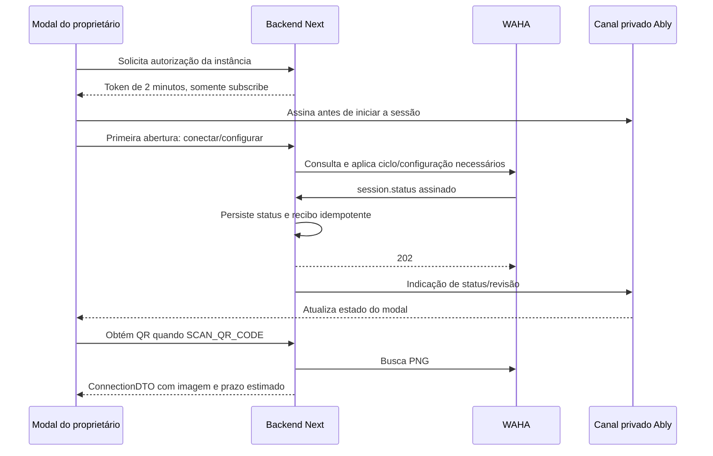

# WAHA + Ably — entrega técnica e continuidade dos alertas automáticos

Data de referência: 29/10/2026. Repositório canônico: `marcai` (produto Tarefaí). O pedido inicial também citava `agentehub-core`; os arquivos e caminhos desta entrega pertencem a este repositório.

Este documento permite continuar o trabalho sem depender do histórico da conversa. Descreve o código e as configurações realizados, os limites comprovados e o plano proposto para a próxima etapa. **O plano de disparo confiável descrito adiante ainda não foi implementado.** Nenhum valor de credencial, telefone real, QR ou endereço privado está incluído.

## 1. Ponto de partida para quem assumir

A gestão de instâncias, conexão por QR, webhooks assinados e atualização via Ably foi implementada. A tela já cadastra as regras do proprietário e até cinco destinatários da organização. Há também um **envio básico já integrado ao processamento de notificações**; portanto, a próxima etapa deve completar e corrigir esse caminho, evitando instalar um segundo disparador que envie a mesma mensagem.

O próximo objetivo é transformar esse envio básico em um fluxo persistente, rastreável e independente das falhas de push/e-mail, aplicando todas as configurações do proprietário. As principais pendências são repetição, idempotência durável por ocorrência/destinatário, recuperação de falhas, correlação de ACK e definição precisa das regras de envio.

Antes de alterar código, ler:

1. [AGENTS.md](../AGENTS.md), incluindo os guias da versão instalada do Next em `node_modules/next/dist/docs/`.
2. [Contrato de acesso a dados](database-access-architecture.md) e [controles de consumo](database-cost-controls.md).
3. **[waha-instancias.md completo](../waha-instancias.md)**: fonte de verdade das operações do provedor. Não inventar endpoints, opções de validade do QR, idempotência do envio ou campos não documentados.
4. [Contrato do backend WhatsApp](whatsapp-instances-backend.md), [desenvolvimento local](whatsapp-local-development.md) e este documento.
5. Código das actions e dos componentes antes de mudar seus contratos.

O backend deste site é canônico. O snapshot do aplicativo `marcai-emp-app` só deve ser atualizado na direção **site → app** quando houver mudança compartilhada.

## 2. O que foi implementado

### 2.1 Tela e permissões

A seção de WhatsApp em `/management/settings` foi simplificada, separando preferências de alertas, instâncias e destinatários.

- Somente `OWNER` pode gerenciar instâncias, destinatários e regras de alerta. O servidor revalida acesso em cada action/rota de gestão; esconder controles na interface não é a autorização.
- Criação por modal com nome e unidade ativa da própria organização.
- Uma instância por unidade, garantida também por índice único no banco.
- Criação inicialmente local, em `PENDING` / aguardando primeira configuração. A primeira abertura configura/conecta a sessão remota.
- Card abre um modal com contexto da unidade, status, imagem do QR e ações de conectar, atualizar e desconectar.
- Modal de conexão redesenhado com menos texto, QR centralizado e ações organizadas.
- Até cinco destinatários normalizados e distintos por organização; limite centralizado em `recipientLimit`, ainda sem regra por plano.
- Destinatários são compartilhados pelos alertas das unidades dessa organização; não há seleção de contatos por unidade na interface atual.
- Máscara de telefone reutilizável em `PhoneInput`, salvando dígitos normalizados e validando país/DDD; números brasileiros têm 12 ou 13 dígitos no servidor. Grupos não fazem parte do cadastro atual.
- Botão “Salvar destinatários” aparece somente quando há alterações não salvas. Ações apresentam sucesso ou erro controlado.

As preferências usam “Salvar configurações”; a lista de destinatários usa sua própria action/botão. Abrir uma instância não salva automaticamente preferências ainda não confirmadas.

### 2.2 Integração de sessões WAHA

Foi criado um client único, exclusivamente no servidor, com `X-Api-Key`, timeout de oito segundos, `no-store`, rejeição de redirecionamento, limite de resposta de 1 MiB e erros públicos sanitizados.

| Operação implementada | Comportamento |
| --- | --- |
| Consultar | `GET /api/sessions/{name}` antes de criar ou operar |
| Criar | `POST /api/sessions`, com `name`, `start: true` e `config` completa |
| Configurar | `PUT /api/sessions/{name}` quando fingerprint/configuração ou URL do webhook divergem |
| Iniciar | `POST /api/sessions/{name}/start` para sessão parada |
| Reiniciar | `POST /api/sessions/{name}/restart` para recuperação de falha ou operação explícita |
| Parar | `POST /api/sessions/{name}/stop`, mantendo o vínculo quando usado isoladamente |
| Desconectar na UI | `logout` e depois `stop` |
| Excluir definitivamente | `logout` e depois `DELETE /api/sessions/{name}` |
| Obter QR | `GET /api/{name}/auth/qr?format=image`, valida PNG e converte para data URL base64 |

O backend aceita operações adicionais de ciclo de vida, mas a UI atual expõe apenas conectar/atualizar/desconectar. Não confundir desconectar com excluir o registro da instância.

Novas sessões remotas usam `INSTANCE-` mais 96 bits aleatórios. O nome não é derivado apenas de organização, unidade ou outro dado público. O nome amigável do card é separado desse identificador.

Configuração aplicada:

- NOWEB store habilitado, `fullSync: false`, `debug: false`, `proxy: null`.
- Metadata com organização, unidade, instância, projeto e finalidade de alertas.
- Um webhook para `session.status`, `message`, `message.any` e `message.ack`.
- Destino no próprio backend: `/api/whatsapp/webhooks/{session}`.
- HMAC por sessão e retentativas constantes com atraso de um segundo e `attempts: 3`.

Reiniciar a sessão sozinho não atualiza a configuração do WAHA. Mudança de domínio ou segredo exige reaplicar a config completa com PUT.

A instalação/edição WAHA precisa suportar as sessões nomeadas e a quantidade de unidades utilizadas. Autenticar a API ou consultar uma sessão não comprova capacidade/licença para múltiplas sessões; conferir isso no ambiente antes de expandir a operação.

### 2.3 Recebimento de webhooks e segurança

O corpo original é verificado antes de interpretar o JSON: HMAC-SHA512 hexadecimal nos headers `X-Webhook-Hmac` e `X-Webhook-Hmac-Algorithm: sha512`. A chave por sessão é derivada de `AUTH_SECRET` com separação de finalidade; a chave da API WAHA não é reaproveitada como segredo do webhook.

O usuário autorizou esclarecer o formato da assinatura na documentação técnica oficial, pois esse detalhe não estava completo no documento local. A referência e os limites dessa consulta constam no [contrato do backend](whatsapp-instances-backend.md).

Outras proteções implementadas:

- Corpo limitado a 256 KiB, schemas Zod e correspondência entre sessão da URL e do evento.
- Timestamp assinado aceito em janela de cinco minutos.
- Recibo persistente com ID único do evento; entregas repetidas não repetem o processamento.
- Estado e recibo gravados em transação; resposta 202 depois da gravação mínima, publicação Ably com `after`.
- Ordenação por timestamp/revisão para impedir regressão por eventos antigos.
- `me: null` não apaga telefone/nome conhecidos.
- Organização/unidade precisam estar ativas na admissão dos eventos.
- Rate limits persistentes por contexto e proteção leve antes da autenticação. A barreira pré-auth é por worker; não substitui o limite persistente.
- Lease de 90 segundos por instância para serializar operações de gestão. Não há chamada de rede dentro da transação do banco.

Limites autenticados atuais, por janela de 60 segundos: criação 6; gravação de destinatários 10; operações 12 por instância; QR 8 por instância; token 30; snapshot 60; webhook válido 180 por sessão. Os escopos completos das chaves estão nos serviços. Esses limites protegem entradas do módulo e não implementam controle de volume de mensagens enviadas.

`message` e `message.any` recebem apenas tratamento de recibo: não disparam IA nem armazenam o texto recebido. `message.ack` armazena hash do ID da mensagem e o ACK, mas **ainda não o relaciona a um registro persistente de entrega de alerta**.

Os recibos de status pendentes de publicação Ably são recuperados em oportunidades seguintes da instância. A manutenção existente remove até 500 recibos já processados/publicados com mais de sete dias. Não foi criada uma fila externa nem um retry autônomo de mensagens WhatsApp. `publishedAt` do recibo não significa que um alerta foi entregue no celular.

### 2.4 Ably, QR automático e redução de requisições

Fluxo implementado:



Canal: `whatsapp:{organizationId}:{locationId}:{instanceId}`. Token emitido somente para o proprietário autorizado, capability `subscribe` no canal exato e TTL de dois minutos. A chave total fica no servidor. Eventos `session.status` e `qr.available` contêm ID local, status e revisão, sem QR, telefone ou corpo de mensagem. O hook atual reage a `session.status` para obter o QR.

O transporte existe apenas com modal aberto e página visível. Há fallback de inicialização após cinco segundos e atualização manual quando o tempo real falha. Conexão saudável não faz replay/consulta por evento ou polling de status. Reabertura/retomada de instância já inicializada recupera o snapshot local autorizado depois de assinar o canal, sem consultar WAHA ou adquirir lease de operação.

O QR muda aproximadamente a cada 20 segundos conforme o documento WAHA. A aplicação usa `qrExpiresAt` estimado em 18 segundos; foi removida a antecipação de um segundo que provocava renovação aos 17 segundos. **Não foi aumentada a validade real do provedor nem existe opção documentada para isso.**

O cache de QR:

- Mantém até 20 imagens somente na memória da tela montada, por instância e revisão.
- Preserva a imagem válida ao fechar/reabrir, mantendo o prazo original.
- Agrupa buscas simultâneas da mesma instância.
- Remove imagem vencida; só renova com modal aberto, página visível e `SCAN_QR_CODE`.
- Invalida por alteração de revisão/status, desconexão, falha de autorização ou desmontagem. Mudar organização remonta a tela.
- Não usa localStorage/sessionStorage e não compartilha QR entre abas.

Também foi corrigida a corrida em que o celular conclui o pareamento enquanto a imagem está sendo buscada: uma recusa/ausência do QR pode significar que a sessão já está `WORKING`. O serviço reconcilia essa exceção uma vez; a UI descarta falhas de transporte antigas após receber a confirmação mais recente, preservando erros de autorização.

## 3. Ambiente, banco e operação local

### 3.1 Variáveis — somente nomes, sem valores

| Variável | Uso |
| --- | --- |
| `WAHA_BASE_URL` | Origem do servidor WAHA; nome canônico adotado pelo usuário |
| `WAHA_KEY` | Credencial WAHA, exclusivamente no servidor |
| `BASE_URL` | Origem pública deste backend para receber webhooks |
| `NEXT_PUBLIC_APP_URL` | Origem do site; fallback de webhook quando não houver BASE_URL; no helper identifica o servidor local |
| `ABLY_API_KEY` | REST/token/publicação, somente no servidor |
| `AUTH_SECRET` | Autenticação existente e derivação HMAC; derivação exige pelo menos 32 caracteres |
| `CLOUDFLARED_PATH` | Opcional: executável do túnel de desenvolvimento |

Aliases antigos do client continuam aceitos (`WAHA_API_URL`, `WAHA_ENDPOINT`, `WAHA_API_KEY`), mas o padrão desta instalação é `WAHA_BASE_URL`/`WAHA_KEY`. Não criar versões públicas dessas chaves. Os segredos não devem ser colocados no documento, código, respostas, logs ou argumentos de shell visíveis.

### 3.2 Dados e migrações

| Modelo / tabela | Finalidade |
| --- | --- |
| `WhatsAppInstance` / `whatsapp_instances` | Organização, unidade, nome amigável, sessão única, status, identidade conhecida, timestamp/revisão, lease e hash de configuração |
| `WhatsAppRecipient` / `whatsapp_recipients` | Nome e telefone normalizado por organização, com unicidade por organização/telefone |
| `WhatsAppWebhookEvent` / `whatsapp_webhook_events` | Recibo idempotente, dados mínimos, horário e controle de publicação/processamento |

Migrações WhatsApp: `20261028210000_whatsapp_instances` e `20261029020000_whatsapp_webhooks`. A primeira também preserva um destinatário individual legado válido. A migração `20261028190000_push_session_binding` foi aplicada no mesmo período para corrigir push, mas não é uma tabela de entrega WhatsApp.

As auditorias registram aplicação dessas migrações ao banco configurado no `.env`, sem reset. **Este documento não confirma o estado atual de todos os ambientes**: conferir `migrate status` na publicação, revisar todas as pendências e aplicar somente no destino correto. Não usar reset, `db push` ou migração de desenvolvimento em produção. Alterações de schema futuras devem ser apresentadas antes de aplicar, conforme pedido do usuário.

### 3.3 Diagnóstico e solução para localhost

O usuário confirmou testes em localhost. No diagnóstico, a sessão WAHA enviava webhooks ao domínio público de `BASE_URL`, cuja rota retornava 404 naquele momento. Assim, o modal aguardava o evento e só mostrava o QR após atualização manual. Isso foi um diagnóstico datado, não uma verificação atual da hospedagem.

Foi preparado um Cloudflare Quick Tunnel com encaminhador que aceita **somente POST no caminho do webhook**. Telas, actions e outras APIs não são expostas por esse túnel. Corpo UTF-8 e assinatura são preservados, com limite de 256 KiB; o backend continua validando HMAC.

O executável foi colocado na pasta ignorada `tmp/waha-tunnel/bin`, sem instalação global. O helper grava apenas o override `BASE_URL` em `.env.development.local`, preservando `.env`; valida o callback antes de gravar e não imprime o endereço/segredos. Há fallback de resolução pública de DNS sem mudar DNS do sistema, hosts ou verificação TLS.

Comandos de desenvolvimento, em terminais separados:

```powershell
npm.cmd run dev
npm.cmd run dev:whatsapp
```

Depois de `ready:true`, abrir a instância como proprietário para aplicar a URL atual com PUT. A URL é temporária; ao reiniciar o túnel, reabrir a instância. Para encerrar e restaurar o override anterior:

```powershell
npm.cmd run dev:whatsapp:stop
```

O túnel foi deixado ativo na sessão de implementação, mas é um processo temporário: **quem assumir deve verificar se ainda está rodando**. Em produção usar HTTPS estável do próprio backend, publicar as rotas e reaplicar os webhooks. Não apontar sessões de outros ambientes para o localhost nem alterar sessões remotas que não pertençam ao projeto.

## 4. Mapa de código e contratos preservados

| Responsabilidade | Arquivo |
| --- | --- |
| Validação, limites, tipos e erros públicos | [contracts.ts](../src/domain/whatsapp/contracts.ts) |
| Casos de uso de gestão e QR | [instances.ts](../src/application/whatsapp/instances.ts) |
| Autorização de token Ably | [authorization.ts](../src/application/whatsapp/authorization.ts) |
| Admissão de webhooks | [webhooks.ts](../src/application/whatsapp/webhooks.ts) |
| Client WAHA | [waha-client.ts](../src/infrastructure/whatsapp/waha-client.ts) |
| Consultas, leases e recibos | [repository.ts](../src/infrastructure/whatsapp/repository.ts) |
| HMAC e origem de callback | [webhook-security.ts](../src/infrastructure/whatsapp/webhook-security.ts) |
| Publicação Ably / barreira pré-auth | [realtime.ts](../src/infrastructure/whatsapp/realtime.ts), [ingress.ts](../src/infrastructure/whatsapp/ingress.ts) |
| Server Actions da seção | [whatsapp-actions.ts](../src/presentation/actions/whatsapp-actions.ts) |
| Gestão e modal | [whatsapp-instances.tsx](../src/presentation/components/organization/whatsapp-instances.tsx), [whatsapp-connection-dialog.tsx](../src/presentation/components/organization/whatsapp-connection-dialog.tsx) |
| Transporte e cache de QR | [use-whatsapp-realtime.ts](../src/hooks/use-whatsapp-realtime.ts), [whatsapp-qr-cache.ts](../src/presentation/realtime/whatsapp-qr-cache.ts) |
| Preferências e persistência | [whatsapp-alert-settings.tsx](../src/presentation/components/organization/whatsapp-alert-settings.tsx), [settings-client.tsx](../src/presentation/components/organization/settings-client.tsx), [org-management-actions.ts](../src/presentation/actions/org-management-actions.ts) |
| Envio básico e avaliação atual de regras | [waha-service.ts](../src/infrastructure/whatsapp/waha-service.ts) |
| Entrada atual de disparo pós-commit | [notification-service.ts](../src/infrastructure/notifications/notification-service.ts), [transaction.ts](../src/infrastructure/notifications/transaction.ts) |
| Helper e proxy local | [dev-whatsapp.cjs](../scripts/dev-whatsapp.cjs), [whatsapp-webhook-proxy.cjs](../scripts/lib/whatsapp-webhook-proxy.cjs) |

Actions atuais:

- `getWhatsAppSettingsAction()`: retorna diretamente `{ instances, recipients, locations, recipientLimit }`; a falha lança erro sanitizado. **Não envolver em `{data}` sem adaptar o consumidor.**
- `createWhatsAppInstanceAction({ name, locationId })` e `saveWhatsAppRecipientsAction(contacts)`: `{data}` ou `{error}`.
- `manageWhatsAppInstanceAction(id, operation)` e `getWhatsAppQrAction(id)`: `{data}` ou `{error, code}`.
- `ConnectionDTO`: `{ status, qr, qrExpiresAt, revision, deleted? }`, com `qr` data URL PNG ou `null`.

Rotas:

| Método e caminho | Contrato |
| --- | --- |
| `POST /api/whatsapp/webhooks/[session]` | Autenticação por assinatura; recebe os quatro eventos configurados |
| `GET /api/whatsapp/instances/[id]/token` | OWNER; `{data:{channel,tokenRequest}}`, sem imagem ou chave total |
| `GET /api/whatsapp/instances/[id]` | OWNER; snapshot local de ID/status/revisão/identidade, sem chamada WAHA |
| `POST /api/whatsapp/instances/[id]` | OWNER e Origin validado; `{operation}` |
| `DELETE /api/whatsapp/instances/[id]` | OWNER e Origin validado; logout remoto e exclusão |

## 5. Disparo automático: o que existe e o que falta

### 5.1 Caminho já existente

```text
Mutação cria notificações por notificationTransaction
  → commit
  → after chama dispatchPersistedNotifications com os IDs confirmados
  → reclama registros QUEUED da outbox de push existente
  → verifica destinatário interno e processa Ably/push/e-mail
  → chama maybeDispatchWhatsAppAlert
  → consulta organização e settings.whatsappAlerts
  → aplica filtros básicos
  → resolve unidade por locationId, tarefa ou execução
  → seleciona instância WORKING dessa unidade/organização
  → lê destinatários da organização
  → check-exists para obter chatId correto
  → sendText para cada destinatário
```

O emissor atual usa a sessão da unidade, sem fallback global entre unidades. O client resolve o `chatId` via `check-exists` antes de cada envio, evitando o problema documentado do nono dígito. Cinco destinatários geram até cinco consultas de existência e cinco envios nesse caminho.

### 5.2 Configurações atuais e lacunas confirmadas no código

| Configuração / aspecto | Situação atual | Trabalho seguinte |
| --- | --- | --- |
| `enabled` | Salvo e aplicado; desabilitado retorna sem envio | Revalidar também antes de entregar trabalho pendente |
| `notificationTypes` | Salvo e filtrado por grupos de eventos; lista vazia atualmente não restringe tipos | Definir explicitamente a semântica de nenhuma seleção e testar |
| `criticalityFilter` | Aplica CRITICAL_ONLY, HIGH_AND_CRITICAL ou ALL | Centralizar schema/avaliação e comportamento de prioridade ausente |
| `triggerStep` | Funciona como mínimo de marco quando o evento informa milestoneStep | Confirmar “a partir de” versus “somente no marco”; tratar ausência de marco |
| `repeatInterval` | Exibido e salvo (UI: 0, 15, 30, 60), mas não é usado por `maybeDispatchWhatsAppAlert` | Implementar agenda persistente e cancelamento por resolução |
| `businessHoursOnly` | Horário fixo: dias úteis, 08h–19h, America/Sao_Paulo | Confirmar fuso/calendário, descarte versus adiamento e implementar cálculo consistente |
| `alwaysUrgent` | CRITICAL pode ultrapassar filtros de tipo, marco e horário; habilitação continua obrigatória | Especificar exatamente o que urgência pode ultrapassar |
| Destinatários | Usa `WhatsAppRecipient`, até cinco na gravação | Política para exclusão/alteração durante fila, plano futuro e falha parcial |
| Campos legados de contato | `recipientPhone`/`recipientName` ainda aparecem no JSON/tipos antigos; envio lê a tabela nova | Não restaurar o contato único como fonte; limpar/adaptar compatibilidade com testes |
| Deduplicação | Set em memória no dispatcher, por organização/tipo/texto/data durante aquela chamada | Chave persistente da ocorrência operacional por destinatário; texto ou usuário interno não bastam |
| Tentativas e recuperação | Não há outbox própria de WhatsApp nem retry durável por destinatário | Persistir intenção/entrega e recuperar de forma limitada e observável |
| Resultado de envio | Agrega sucesso/falha; não persiste os IDs retornados de cada destinatário no dispatcher | Registrar resultado individual e correlação de ACK |
| ACK | Recibo assinado/hash já existe | Relacionar sessão + mensagem à entrega e avançar estado de forma idempotente |
| Acoplamento | WhatsApp roda dentro do processamento da outbox de push, depois de outros canais | Separar falhas e elegibilidade por canal; evitar que erro anterior impeça o WhatsApp |
| Cobertura dos gatilhos | Depende das notificações criadas e admitidas naquele caminho | Inventariar todos os eventos e suas transações, inclusive ocorrências sem destinatário interno elegível |
| Validação das regras | Action restringe OWNER e converte campos, mas a validação é menos rigorosa que os schemas de instâncias/contatos | Schema único com enums/intervalos/faixas e rejeição de entradas inválidas |

Grupos atuais de eventos em `WHATSAPP_EVENT_TYPES`:

| Preferência da tela | Tipos aceitos hoje |
| --- | --- |
| TASK_OVERDUE | TASK_OVERDUE, TASK_TOLERANCE_EXCEEDED, SLA_BREACH |
| IMPEDIMENT_REPORTED | IMPEDIMENT_REPORTED, OPERATIONAL_ALERT, VALIDATION_EXCEPTION |
| APPROVAL_PENDING | APPROVAL_PENDING, APPROVAL_REQUESTED, APPROVAL_OVERDUE |
| DEADLINE_WARNING | DEADLINE_WARNING, TASK_EXPIRING_SOON, CRITICAL_TASK_ALERT |
| PROCESS_STALLED | PROCESS_STALLED, PAUSE_ALERT |

Esse mapa não comprova que todos esses tipos são efetivamente produzidos em todos os fluxos. Verificar produtores, IDs, unidade e dados do marco antes de prometer cobertura.

**Não confundir garantias:** idempotência de webhook/lease de gestão já implementadas não garantem idempotência de envio. Resposta positiva do `sendText` não comprova entrega no aparelho. `message.any` com ACK 1 significa aceitação pelo servidor; ACK 2 indica entrega, 3 leitura, 4 áudio ouvido, -1 erro, conforme o documento WAHA.

Há ainda helpers legados `resolveWahaConfig`, `checkWahaSessionStatus` e `testWahaConnectionAction`, com referências a sessão `default`/parâmetros de sessão. Não são a base da UI nova. Auditar usos e autorização ou descontinuar com compatibilidade; não reintroduzir seleção arbitrária de sessão remota ou endpoint pelo cliente. O envio multiunidade deve sempre resolver a instância pelo contexto confiável do backend.

## 6. Próxima etapa — plano proposto, ainda não executado

### Etapa A — fechar as regras e inventariar eventos

Ler os produtores de notificações, os fluxos de tarefa/execução/aprovação e o [agendador operacional existente](operational-scheduler.md). Registrar, para cada alerta, evento de origem, ID da ocorrência, organização, unidade, prioridade, marco e condição de resolução.

Confirmar com o proprietário antes de codificar as decisões que a tela não resolve:

1. Nenhum tipo selecionado significa nenhum envio? Recomendação: sim; mudar o comportamento atual de forma explícita.
2. “Uma única vez” vale por incidente, por marco ou por ocorrência reaberta? Marcos são mínimo ou seleção exata?
3. Repetição continua enquanto qual condição estiver aberta? Conta desde o evento ou desde o último envio aceito? O que faz após indisponibilidade longa?
4. Fora de horário: descartar ou agendar para a próxima janela? Qual fuso e calendário devem valer?
5. “Urgente” pode ignorar quais filtros? Deve continuar respeitando desativação geral, isolamento, contatos autorizados e limites.
6. Instância offline: adiar, descartar após TTL ou permitir recuperação manual? Ao reconectar, evitar rajada de alertas antigos.
7. Alterar regras/contatos afeta pendências existentes? Recomendação: revalidar antes do envio e nunca enviar para contato removido.
8. O que acontece com tarefa sem unidade ou com unidade inativa? Não escolher uma sessão global automaticamente.

Entrega: matriz de decisão e schema tipado único de preferências, coerentes entre UI, gravação e avaliação. Reutilizar grupos de evento somente depois de conferir o inventário.

### Etapa B — persistir ocorrência e entregas idempotentes

Desenhar a persistência no padrão existente do projeto, avaliando reaproveitamento dos registros de entrega antes de criar novos modelos. **Apresentar schema, índices e migração antes de aplicar.** Esta entrega não cria essas tabelas.

O desenho precisa representar, de forma conceitual:

- Ocorrência operacional e sua organização/unidade; ID/versionamento que diferencie incidentes legítimos.
- Entrega individual por destinatário, com chave única estável incluindo ocorrência e rodada/marco de repetição quando aplicável.
- Sessão/instância escolhida e correlação da mensagem do provedor, com retenção mínima necessária.
- Estado, disponibilidade, tentativas limitadas, lease, horários e erro público/código sanitizado.
- Motivo de supressão/cancelamento e versão das regras usada na avaliação, sem copiar segredos ou texto privado desnecessário.

Exemplo conceitual de chave: organização + ocorrência de domínio + unidade + destinatário normalizado + rodada. A chave final depende das decisões da etapa A. Não usar o ID de cada notificação de usuário como única identidade de um evento compartilhado por vários gestores.

A intenção durável deve acompanhar a transação que confirma o evento de negócio, quando possível. `after` pode iniciar o transporte depois do commit; não deve ser a única memória de que o envio precisa acontecer. Não chamar WAHA dentro de transações nem enviar após rollback.

Se o projeto optar por aproveitar a infraestrutura de notificações, separar corretamente elegibilidade/estado por canal: permissão do destinatário interno de push não substitui a regra de entrega aos contatos da organização.

### Etapa C — processar envios com isolamento e falha parcial

Criar um serviço de aplicação que reclama entregas elegíveis de modo atômico, com lotes e concorrência limitados, e usa o client WAHA existente. Remover/substituir o disparo antigo no mesmo momento para impedir dois caminhos ativos.

Antes de enviar, revalidar organização/unidade ativas, incidente ainda elegível, preferências habilitadas, contato vigente e instância da unidade. A autorização administrativa das configurações continua exclusiva do proprietário; execução em background usa identidade de serviço autorizada, sem depender de uma sessão de navegador aberta.

Resolver `chatId` com `check-exists` e enviar pela sessão correta. Se for introduzido cache dessa resolução, definir validade, escopo por organização/sessão/telefone, invalidação e limites; atualmente a checagem ocorre por envio. Não presumir suporte a grupos a partir de helpers antigos.

Persistir o resultado de cada destinatário separadamente. Falha em um dos cinco não deve repetir os outros quatro. Push/e-mail indisponíveis não devem impedir o canal WhatsApp, nem falha WhatsApp reverter a operação de negócio.

Definir timeout e falha ambígua: o provedor pode aceitar uma mensagem e a conexão cair antes da resposta. O documento WAHA não oferece uma chave de idempotência de `sendText`; portanto **não prometer exatamente uma entrega nem repetir cegamente após timeout**. Propor estado de resultado desconhecido, reconciliação quando possível e política explícita para esse caso.

Rate limit de actions/webhooks não é rate limit de envio. Definir limites de saída por organização/instância, proteção contra rajada e tratamento controlado das respostas do provedor, sem inventar uma taxa “segura” não validada.

### Etapa D — repetição, horários e recuperação sem polling novo

Integrar os próximos horários ao mecanismo persistente de agenda/sinais já existente, respeitando suas leases, orçamento e revisão, ou propor uma adaptação justificada. Não criar timer no navegador, loop de consultas a cada poucos segundos ou novo cron de varredura global.

Persistir a próxima ocorrência; reavaliar condição e regras ao vencimento. Cancelar/invalidar pendências ao resolver o incidente, desativar alertas, remover destinatário ou inativar o contexto. Definir coalescência/TTL para não enviar todas as repetições atrasadas após uma queda.

Trabalho vencido precisa de uma entrada de execução real no servidor: `after` ou um webhook isolado não garante que uma repetição futura aconteça. Conferir o job autenticado existente e sua configuração de ambiente. Não reativar `/api/jobs/mobile` ou alterar silenciosamente flags operacionais para fazer o WhatsApp funcionar.

Aplicar fuso/horário com utilitários consistentes do projeto; substituir a conversão ad hoc atual somente com testes das janelas e da política acordada.

### Etapa E — ACK, auditoria e suporte operacional

Relacionar o ID retornado pelo envio à sessão e à entrega. Como o receptor guarda hash do ID, a correlação deve usar o mesmo algoritmo e escopo, com tratamento para ACK chegar antes de persistir a resposta HTTP.

Processar ACK duplicado/fora de ordem sem regredir de lida para entregue. Distinguir aceitação pelo provedor, entrega no dispositivo, leitura, falha e resultado desconhecido. Não converter falta de ACK automaticamente em falha nem registrar sucesso de entrega apenas por resposta HTTP positiva.

Prever diagnóstico autorizado ao proprietário: motivo de supressão, pendência, resultado individual e retentativa permitida. Métricas por estado/tipo/organização, com acesso controlado e sem credenciais, conteúdo completo ou telefones em logs. Definir retenção para histórico e para a correlação de mensagens, separada da limpeza dos recibos atuais quando necessário.

### Etapa F — testes, publicação e comprovação real

Implementar testes sintéticos antes de ativar o novo dispatcher. Homologação real deve usar unidade/contatos de teste autorizados e eventos controlados; não disparar para toda a base como teste.

Critérios mínimos:

- Dois workers ou duas notificações internas do mesmo evento não enviam duplicatas intencionais ao mesmo destinatário/rodada.
- Rollback gera zero envios; falha de transporte não desfaz a mutação confirmada.
- Somente a sessão da unidade/organização correta é usada, sem fallback entre contas/unidades.
- Todas as combinações aprovadas de tipo, prioridade, marco, urgência e horário seguem a matriz.
- Cinco contatos recebem resultados independentes; contato inválido/removido e falha parcial são tratados.
- Repetição respeita prazo e termina quando o incidente é resolvido; reinício não perde agenda nem cria rajada.
- Configuração desabilitada ou alterada é revalidada antes de enviar pendência.
- Timeout ambíguo não provoca retry cego; idempotência local e seus limites estão documentados.
- ACK antecipado, repetido ou fora de ordem atualiza a entrega correta e não vaza entre sessões.
- Endpoint/job exige autenticação; inputs/regras validados; segredos não aparecem no cliente/logs/erros.
- QR e tempo real continuam passando nos testes existentes, sem consultas extras por evento saudável.
- Ciclo sem trabalho preserva o contrato de baixo custo; sem polling novo nem scans globais frequentes.

Publicar migrações revisadas antes do código dependente, com estratégia de ativação gradual e reversão do dispatcher sem apagar histórico. Evitar overlap com o disparo atual. Atualizar documentação/testes de custo e snapshot compartilhado na direção site → app. Confirmar callback HTTPS, pareamento e uma entrega/ACK reais antes de declarar o módulo integralmente concluído.

## 7. Evidências e comandos para continuidade

Validações anteriores registradas nas auditorias:

- Backend: suíte isolada WAHA e suíte geral de eficiência, tipos, comparação de schema e build webpack aprovados na etapa de implementação.
- App: snapshot canônico conferido em 211 arquivos; workflow, tipos e 322 testes aprovados naquela etapa. A última alteração de cache, apenas de frontend do site, manteve o snapshot coincidente.
- Última alteração de QR: tipagem aprovada e teste real de componente/hook com transportes simulados em 1200 px e 390 px, incluindo cache, prazo original, busca pendente, autorização e corrida com WORKING.
- Proxy/túnel: corpo UTF-8/HMAC preservado, somente POST permitido no caminho do webhook, outras rotas bloqueadas e limite de corpo verificados.
- Diagnóstico do túnel: callback público sem assinatura alcançou o backend e respondeu 401; outra rota pelo túnel retornou 404; override local foi reconhecido pelo Next.

Essas evidências são datadas. Testes simulados não comprovam pareamento, envio ou ACK em produção. Não houve envio real feito pelo agente para validar o disparo automático; o relato do usuário de conexão pelo celular não comprova a política completa de alertas. A publicação atual deve ser conferida por quem assumir.

Comandos de verificação, sem credenciais externas nas fixtures:

```powershell
npm.cmd run typecheck
npm.cmd run test:whatsapp:ui
npm.cmd run test:whatsapp:tunnel

# Exige PostgreSQL 18 descartável no loopback fixo do executor.
# Nunca adaptar para usar DATABASE_URL de produção ou carregar .env nos testes.
node scripts/test-database-efficiency.cjs --whatsapp-only
node scripts/test-database-efficiency.cjs
node scripts/test-database-efficiency.cjs --build --webpack
```

Fontes das evidências: [instâncias iniciais](audits/whatsapp-instances-2026-10-28.md), [backend e correção da corrida de QR](audits/whatsapp-backend-2026-10-29.md), [localhost](audits/whatsapp-localhost-2026-10-29.md), [cache e custo de QR](audits/whatsapp-qr-cache-2026-10-29.md).

O workspace contém alterações de push, notificações e outros trabalhos além do WAHA. Conferir `git status` e os diffs antes de assumir autoria, descartar arquivos, preparar commit ou publicar. Não fazer reset geral para “limpar” a investigação.

## 8. Instrução curta para entregar ao próximo responsável

> Continue a partir de `docs/whatsapp-handoff.md`. Leia integralmente `waha-instancias.md`, os contratos de banco/custo e os arquivos atuais antes de alterar código. A conexão WAHA + Ably já existe; há um envio básico em `maybeDispatchWhatsAppAlert`, chamado por `dispatchPersistedNotifications`. Complete esse caminho sem duplicar disparadores. Primeiro confirme a matriz de regras do proprietário; depois proponha persistência/idempotência por ocorrência e destinatário, isolamento dos canais, repetição na agenda existente e correlação de ACK. Apresente schema antes de aplicar migrações. Preserve segurança multiempresa, QR em cache e ausência de polling de status. Demonstre os critérios de aceite deste documento com testes isolados e homologação controlada.
